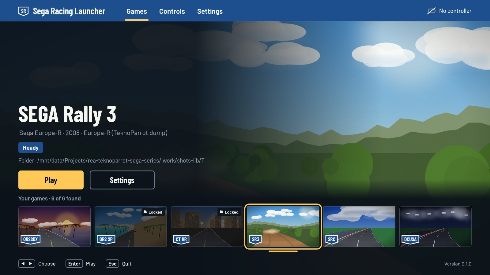
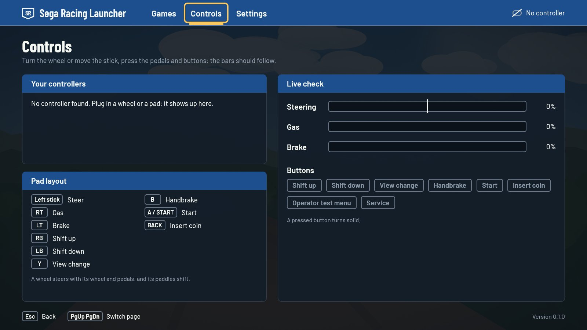
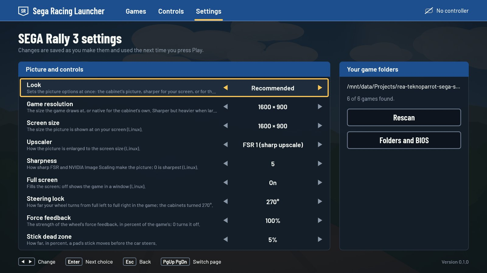

# Sega Racing Arcade Series Launcher

Play your own dumps of seven Sega arcade racers on Linux, with your wheel
or pad: OutRun 2 SP SDX, OutRun 2 SP Special Tours, Crazy Taxi High Roller,
SEGA Rally 3, SEGA Racing Classic, Daytona Championship USA and F355
Challenge 2. Point the
launcher at the folder with your TeknoParrot game folders and press **Play**.
The loaders, Wine and the settings each game needs come with it or are set up
for you. Your game folders are only read, never changed: every game plays
from the launcher's own private copy.

This project contains no game files: you need your own dumps.

> **Work in progress.** OutRun 2 SP SDX, SEGA Rally 3, SEGA Racing Classic and
> Daytona Championship USA play full races through the launcher on Linux.
> F355 Challenge 2 starts and reaches its attract mode on Linux (and under
> Wine with the Windows build), but hasn't been played with controls yet. OutRun 2 SP Special Tours and Crazy Taxi
> High Roller are still being brought up. Wheels, the
> Windows build and the Steam Deck are not tested on hardware yet
> ([docs/RUNTIME_NOTES.md](docs/RUNTIME_NOTES.md)). Reports are welcome at
> <https://github.com/akitaonrails/rea-teknoparrot-sega-series/issues>.

<!-- Showcase video: the owner records it and hosts it outside the
repository, with its poster image. -->

## Problems this launcher solves

| Problem | What the launcher does |
| --- | --- |
| Each cabinet needs its own loader, Wine setup and tweaks. | One window finds every game in your folders and starts each with the right loader: lindbergh-loader for OutRun 2 SP SDX, windowsarcadeloader for SEGA Rally 3, SEGA Racing Classic and Daytona Championship USA. |
| TeknoParrot doesn't run on Linux, and its loader refuses Wine. | Open loaders made for Linux run the games natively or under a bundled Wine (GE-Proton); Daytona Championship USA gets a windowsarcadeloader profile written for this launcher. |
| SEGA Racing Classic's sound crashes under plain Wine. | The prefix gets native XAudio2 the first time, from Microsoft's runtime inside the package (no download). |
| OutRun 2 SP SDX stops at its cabinet check on a PC. | The launcher turns on lindbergh-loader's cabinet-check skip. |
| The cabinets had a 4-speed H lever, a handbrake and four view buttons. | Paddles or shoulder buttons shift up and down; the launcher turns that into the H lever's gears, and one view button walks through the four cameras. |
| A wheel turns 900° or more; the cabinets turned 270°. | The launcher reads your wheel and sets the steering lock you pick (270° by default), with force feedback from the game at the strength you choose. |
| Games write logs, settings and rankings next to their files. | Those folders are real copies in the launcher's runtime, so your dumps stay untouched (they're mounted read-only while a game runs). |
| Cabinet resolutions are small (800×480, 1280×720). | Each game draws at a larger size where it can, and the picture is scaled to your screen with FSR. |

## Screenshots

| Games | Controls | Settings |
| --- | --- | --- |
|  |  |  |

## What you need

- Your own TeknoParrot dumps of the games, one folder each, as the community
  shares them (the launcher knows each game by the SHA-256 of its main
  file, and lists any build it doesn't know).
- Linux on x86-64 with a Vulkan driver, gamescope and bubblewrap (most
  gaming setups have them). The release package brings Wine, the loaders
  and everything else.
- Your BIOS folder, for three of the games (EmuDeck's `bios` folder works):
  F355 Challenge 2 needs MAME's `f355bios.zip`; the two Chihiro games need
  MAME's `chihiro` files (media board ROM and the three base-board
  EEPROMs).
- A wheel or a gamepad. The keyboard works for menus only.

The launcher runs the dumps as the arcade community distributes them. Their
loaders answer the cabinets' security and I/O boards; the launcher itself
doesn't remove or patch any protection, and can't help you get the games.

## Download and install

1. Download `SegaRacingLauncher-<version>-linux-x86_64.tar.gz` from the
   [latest release](https://github.com/akitaonrails/rea-teknoparrot-sega-series/releases/latest).
2. Unpack it anywhere you like (it stays in its folder).
3. Run `sega-launcher` from that folder.

A Windows package (`…-windows-x86_64.zip`) is built too; it runs the
windowsarcadeloader games without Wine. It is not tested on Windows yet.

## First run

The first window asks for the folder that holds your game folders. Type its
path and press **Add folder**; add more folders if your games are spread out.
The launcher looks inside, lists what it found, and opens the hub. For
F355 Challenge 2 and the Chihiro games, add your BIOS folder under
**Settings → Folders and BIOS**.

## The settings window

- **Games**: a tile per game, its picture, edition, folder and state, and
  **Play**. A game that can't start yet says why.
- **Controls**: the wheels and pads the launcher sees, which one drives the
  car, the pad layout, and a live check of steering, pedals and buttons.
- **Settings**: the selected game's picture and wheel options, saved as you
  change them, plus your game folders and BIOS folder.

Everything works with a mouse, the keyboard or a pad: the d-pad or left
stick moves, A chooses, B goes back, Start plays, Y opens Settings, the
shoulder buttons change tabs. While a game runs the pad belongs to the game.
Options a game can't use here are shown greyed out with the reason (on
Windows: the screen-size, upscaler, sharpness and full-screen rows, which
are for gamescope on Linux).

## Gamepad

Triggers are the pedals, the left stick steers, the shoulder buttons shift,
Y changes the view, B is SEGA Rally 3's handbrake, Start (or A) starts, Back
inserts a coin. On a wheel, the paddles shift.

## Options

Each game keeps its own options. Every option is a line in that game's
settings file and a flag for `--play <game>` or `--set <game>`. A game's
look is decided for your screen the first time its settings are read
(the window knows the screen; the command line on Linux doesn't, so it
uses the 1920×1080 look for that run without saving it). `--look` comes
first and the other flags win; any picture flag makes the look Custom.

| Option | Flag | What it changes |
| --- | --- | --- |
| Look | `--look original\|recommended\|steam_deck` | The picture options at once: the cabinet's picture, sharper for your screen, or for the Steam Deck |
| Game resolution | `--render <WxH>\|native` | The size the game draws at |
| Screen size | `--output <WxH>` | The size it is shown at on your screen |
| Upscaler | `--upscaler fsr\|nis\|linear\|nearest` | How the picture is enlarged |
| Sharpness | `--sharpness 0-20` | FSR and NVIDIA Image Scaling sharpness (0 is sharpest) |
| Full screen | `--fullscreen on\|off` | Full screen or a window |
| Steering lock | `--steering-lock 180\|270\|360\|540\|900\|full` | How far your wheel turns lock to lock in the game |
| Force feedback | `--force-feedback 0-200` | The wheel's force, in percent of the game's |
| Stick dead zone | `--deadzone 0-30` | How far a stick moves before the car steers |

Other commands: `--list` (what was found; works while the window is open),
`--check [<game>]` (what could start, without starting), `--library
<folder>`, `--bios <folder>`, `--help`. `--game <game>` is `--set`'s old
name.

## Where things live

- Settings, runtimes and logs: `~/.local/share/rea-sega/` (`launcher.cfg`,
  `settings/<game>.cfg`, `runtimes/<game>/` with each game's saves, rankings
  and `session.log`, `wal/` with the Wine prefix).
- On Windows: `%LOCALAPPDATA%\rea-sega\`.

## Troubleshooting

- **A game says it is not in your folders**: run `sega-launcher --list`. An
  unknown build is listed with its SHA-256; please
  [report it](https://github.com/akitaonrails/rea-teknoparrot-sega-series/issues/new?template=unknown-edition.yml).
- **A game stops right away**: the launcher says so, with the lines of the
  game's log that tell why; the whole log is `runtimes/<game>/session.log`,
  and every message is also in `launcher.log`.
- **The wheel turns the wrong way or too far**: set the steering lock in
  Settings, and turn off your wheel software's own lock.
- Anything else: [open a bug report](https://github.com/akitaonrails/rea-teknoparrot-sega-series/issues/new?template=bug-report.yml)
  with the game's `session.log`.

## Known limitations

- OutRun 2 SP Special Tours and Crazy Taxi High Roller can't start yet.
  Cxbx-Reloaded boots SEGABOOT and then OutRun 2 SP under Wine with MAME's
  Chihiro files, but the screen stays black.
- Daytona Championship USA: the view and gear buttons are mapped from the
  game's own table but not yet seen working in a race (races so far used the
  automatic transmission). Coins are needed (free play off).
- F355 Challenge 2's two linked boards sometimes fail to find each other at
  boot; the launcher then starts the game again by itself, so the first
  start can take a minute or two. The Windows version was tried under Wine
  only, not yet on Windows itself.
  Wheels aren't set up for it yet; use a pad or the keyboard.
- OutRun 2 SP SDX runs only in the Linux version (it's a Linux game).
- No wheel has been tried on hardware yet.

## Uninstall

Delete the launcher's folder, then `~/.local/share/rea-sega/` (on Windows
`%LOCALAPPDATA%\rea-sega\`). That folder holds the games' rankings and
operator settings: copy `runtimes/` first if you want to keep them.

## For developers

Rust workspace: `crates/sega-core` (catalog, runtime folder rules,
option table, launch plans; host-tested) and `crates/sega-launcher` (the
hub's backend, the command line, sessions, the input wire). `AGENTS.md` has
the checks and the layout.

```sh
cargo test --workspace
scripts/build-components.sh dist/components    # lindbergh-loader, windowsarcadeloader, GE-Proton, winetricks, DirectX redist
SEGA_COMPONENTS=dist/components cargo run -p sega-launcher
```

## How it works

Each game runs from a private runtime folder: links to the dump, real
copies of what the game writes. SEGA Rally 3 and SEGA Racing Classic run in
windowsarcadeloader under GE-Proton's Wine (Daytona through a profile of
our own that plays the Sega Shell and its force feedback helper), with the launcher feeding the
cabinet's controls through its input pipe and playing the force feedback
it sends back. OutRun 2 SP SDX runs natively in lindbergh-loader, which
reads the controls itself. Every game runs in gamescope (scaling) inside
bubblewrap (the dumps read-only).

## Built on rea-launcher-sdk

The hub window, the command line, the library scan, the runtime folder of
links, gamescope's command line, the game's process group and its run, the
SDL input thread, the option table, settings parsing, wheel and pad logic,
force feedback, messages, single instance, packaging and CI come from
[rea-launcher-sdk](https://github.com/akitaonrails/rea-launcher-sdk) (its
TeknoParrot hub modules, shared with the Initial D, Nintendo and Wangan
launchers), pinned by tag in `Cargo.toml` and vendored in `sdk/`. The game
catalog, the routes, what each game's runtime folder holds, F355's boards,
the cabinets' button layouts, the look and the windowsarcadeloader patches
are this launcher's own.

## Contributing

- **About these games** (their editions, routes, settings, this README):
  issues and pull requests here.
- **Shared code** (settings-window widgets, the option table, wheel and pad
  logic, packaging helpers, CI workflows, anything under `sdk/`): issues and
  pull requests at [rea-launcher-sdk](https://github.com/akitaonrails/rea-launcher-sdk/issues).
- **How to tell:** code under `sdk/` or from a `rea_launcher*` crate is the
  SDK's. If the same problem would happen with another rea launcher, it's
  the SDK's. Not sure? Open it here and it will be moved.
- Never patch `sdk/` or copy SDK code here: fix the SDK and bump the tag.
- Never attach game files (executables, saves, BIOS, data) to an issue.
- Test reports are welcome: [bug report](https://github.com/akitaonrails/rea-teknoparrot-sega-series/issues/new?template=bug-report.yml).

## Credits

- [lindbergh-loader](https://github.com/lindbergh-loader/lindbergh-loader) (the Lindbergh Development Team): runs OutRun 2 SP SDX.
- [windowsarcadeloader](https://github.com/aderumier/windowsarcadeloader) (Alexandre Derumier): runs SEGA Rally 3, SEGA Racing Classic and, with our profile, Daytona Championship USA.
- [Cxbx-Reloaded](https://github.com/Cxbx-Reloaded/Cxbx-Reloaded): the Chihiro route being brought up.
- [GE-Proton](https://github.com/GloriousEggroll/proton-ge-custom) (GloriousEggroll) and [Wine](https://www.winehq.org/): the Windows games on Linux.
- [winetricks](https://github.com/Winetricks/winetricks): native XAudio2 in the prefix.
- [SDL](https://www.libsdl.org/): wheels, pads and force feedback.
- TeknoParrot (Teknogods): its GPL-era UI documented each cabinet's controls.
- Barlow fonts (Jeremy Tribby, SIL OFL).
- [rea-launcher-sdk](https://github.com/akitaonrails/rea-launcher-sdk).

Full list with licences: [THIRD_PARTY.md](THIRD_PARTY.md).

## Legal

OutRun 2 SP, Crazy Taxi, SEGA Rally 3, SEGA Racing Classic and Daytona are
trademarks of SEGA or their owners. This project is not affiliated with or
endorsed by SEGA, TeknoParrot or any of the projects above. It contains no
game files and only runs dumps you own. Our code is GPL-3.0-or-later
([LICENSE](LICENSE)), because the bundled windowsarcadeloader is GPL-3.0;
bundled parts keep their licences ([THIRD_PARTY.md](THIRD_PARTY.md)), and
their sources are listed in the packages' `licenses/SOURCES.txt`.
